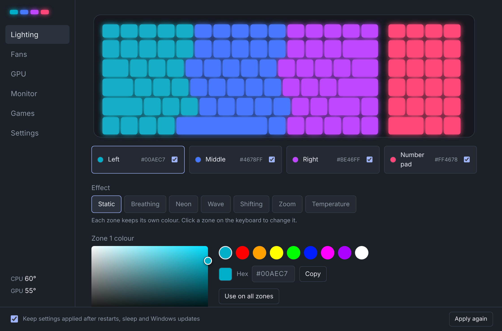
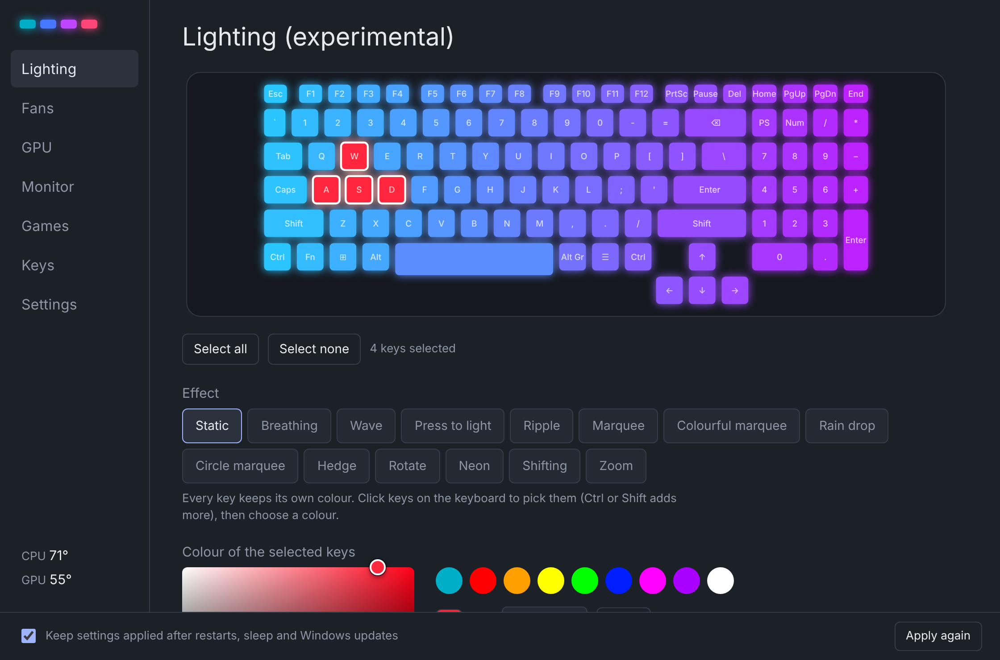
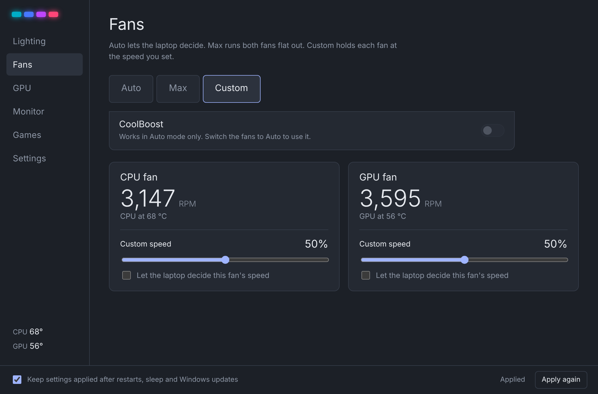
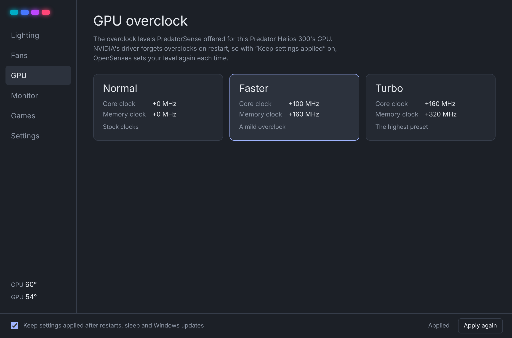
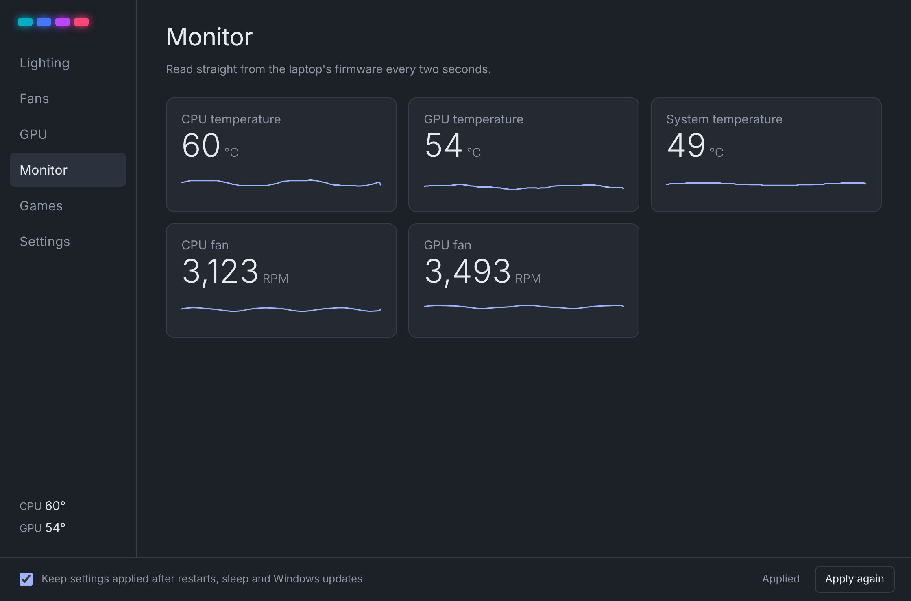
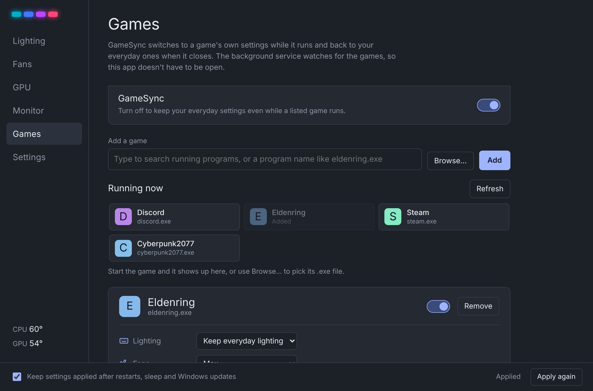
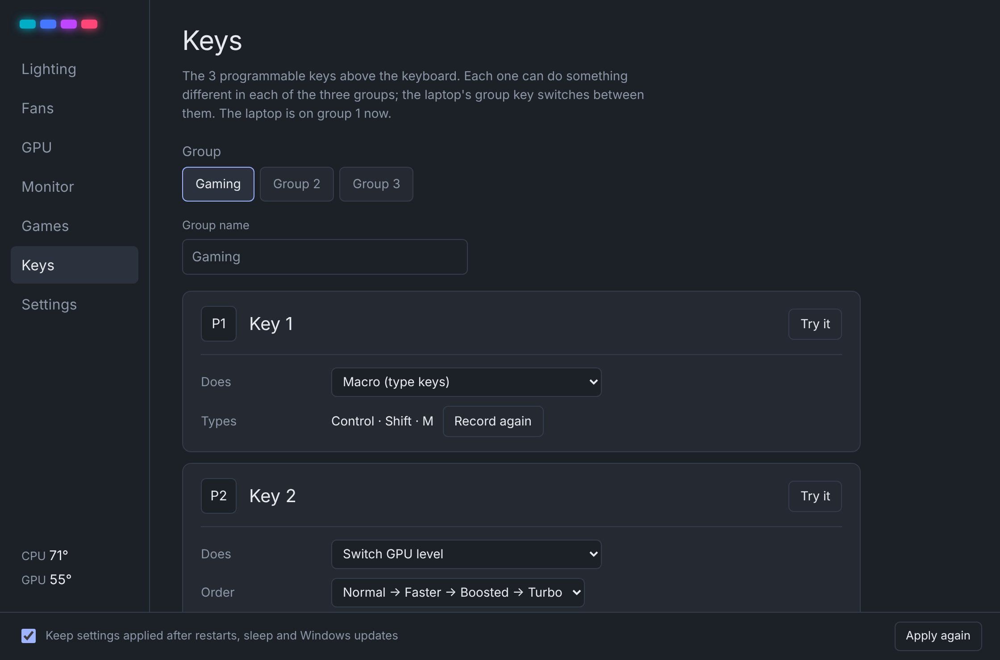
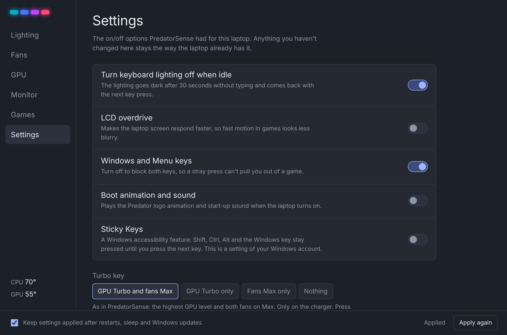

<p align="center">
  
</p>

<h1 align="center">OpenSenses</h1>

<p align="center"><b>OpenSenses</b> is a free, open source alternative to <b>Acer PredatorSense</b> for <b>Predator</b> laptops. Keyboard lighting, fan control, GPU overclock levels, the Turbo key, programmable keys and temperatures, on <b>Windows</b> and <b>Linux</b>.</p>

&nbsp;

> [!WARNING]
> **Experimental software, use it at your own risk.** OpenSenses changes low-level hardware settings and most of it couldn't be tested on real hardware. Please read the [Disclaimer](#disclaimer) before installing.

&nbsp;

# **Why OpenSenses?**

I have an Acer Predator Helios 300 (PH317-53). PredatorSense stopped working for me: the version I had installed wouldn't open anymore, Windows updates kept resetting its settings, and Acer has removed the download for my model from its website, so there was no way to get it back. Without it there was no way to control the keyboard lighting, the fans or the GPU levels.

So I built my own. I also wanted it to run on **Linux**, to make it easier for people with these laptops who use Linux, or who are thinking of switching, to keep these features. Keep in mind the Linux version hasn't been tested on real hardware yet, so it may or may not work there.

&nbsp;

# **Overview**

🌈 **Keyboard lighting**  
All four keyboard zones in any colour, plus Breathing, Neon, Wave, Shifting and Zoom with speed, brightness and direction. A Temperature mode turns the keyboard from blue to red as the CPU heats up. On the Helios 700 and Triton 900, every key gets its own colour, with 13 built-in effects and the heat pipe, fan and touchpad lights.

🌀 **Fan control**  
Auto, Max or a fixed speed for each fan, plus **CoolBoost** for extra cooling in Auto mode. If the laptop gets too hot in Custom mode, the fans go to Max until it cools down.

🚀 **GPU overclock and Turbo**  
PredatorSense's Normal, Faster and Turbo levels, with the same clock offsets it used for your GPU. The fans' built-in curve follows the level, as in PredatorSense. The **Turbo key** works again: on the charger it switches to the highest level with the fans on Max, and you can choose what it does.

⌨️ **Programmable keys**  
On laptops with programmable keys (Helios 500, Helios 700, Triton 900), each key can switch GPU/CPU levels or fan modes, toggle Turbo, the Windows key or Sticky Keys, open a program or type a recorded macro, in three groups. The PredatorSense key opens OpenSenses.

🎮 **GameSync**  
Give a game its own lighting, fan mode, GPU level and Windows key setting. They switch in when the game starts and back when it closes.

🔁 **Keeps your settings**  
A small background service applies your settings at startup and after sleep, and puts them back if a Windows update or anything else changes them. The app doesn't need to be open.

↩️ **Restore anytime**  
OpenSenses saves your laptop's settings before it changes anything and can put them back with one button. Uninstalling it does this automatically. See [what comes back](#restore-original-settings).

🐧 **Windows and Linux**  
The same features on both. Linux uses a small kernel driver that comes with OpenSenses.

&nbsp;

# **Instructions**

1. **Install:** Download OpenSenses for your system from [Download](#download) and install it. It asks for administrator rights once to set up its background service.
2. **Lighting:** Pick an effect, click a zone (or keys, on per-key keyboards) on the keyboard picture and drag the colour picker, or paste a hex colour.
3. **Fans & GPU:** Choose a fan mode and a GPU level. Anything you don't touch stays the way the laptop already has it.
4. **Games:** Open **Games**, click a running game (or **Browse…** to its program file) and choose what changes while you play.
5. **Done!** You can close the app; the background service keeps everything applied.

&nbsp;

> [!TIP]
> **Got a Turbo key?** Press it on the charger for the highest GPU level with the fans on Max, and again to go back. You can choose what it does in **Settings → Turbo key**.

> [!NOTE]
> Close or uninstall PredatorSense first if it's still installed, so the two don't fight over the same settings.

&nbsp;

# **Restore Original Settings**

Before it changes anything, OpenSenses saves your laptop's own settings. If something isn't right, open **Settings → Restore original settings** to put them back. OpenSenses then leaves the laptop alone until you change something again. Uninstalling OpenSenses does this automatically.

Lighting colours, fan modes and speeds, the GPU level and clocks, the fan curve, the Turbo LED and the on/off settings all come back. A few things can't be read from the laptop beforehand, so they can't:

| What | After Restore |
| ---- | ------------- |
| Keyboard lighting effect (Wave, Breathing…) | The zone colours come back; the effect stays as you last set it |
| CPU level | Back to Normal, the laptop's start-up setting |
| Helios 700 / Triton 900 per-key lighting, heat pipe, fan and touchpad lights, idle lighting | Stay as you last set them |
| Sticky Keys | A setting of your Windows account or Linux desktop; turn it off there if you changed it |

Your OpenSenses settings, game profiles and key assignments are kept, since they only live in OpenSenses.

&nbsp;

# **Download**

[](https://github.com/Desiwah/OpenSenses/releases/latest)

[](https://github.com/Desiwah/OpenSenses/releases/latest)

**Linux packages:**

| Distribution | Package |
| ------------ | ------- |
| Ubuntu, Debian, Linux Mint, Pop!_OS, Zorin | `.deb` |
| Fedora, Nobara, openSUSE | `.rpm` |
| Arch, Manjaro, EndeavourOS and others | AppImage |

The `.deb` and `.rpm` set up everything, including the driver (built with DKMS, so it's rebuilt after kernel updates). With the AppImage, open the app and click **Set up service**. The driver needs your kernel's headers (`linux-headers-…` or `kernel-devel`), and with Secure Boot on you'll be asked once to enroll a signing key.

The Turbo key and the programmable keys need Linux 6.12 or newer.

On image-based systems like **Bazzite**, **Fedora Silverblue** or **SteamOS**, drivers can't be added on the system itself, so only temperatures work there until the driver is included in the system.

&nbsp;

# **Screenshots**

<a href="assets/screenshots/lighting.png">
  
</a>
<a href="assets/screenshots/per-key.png">
  
</a>

<a href="assets/screenshots/fans.png">
  
</a>
<a href="assets/screenshots/gpu.png">
  
</a>

<a href="assets/screenshots/monitor.png">
  
</a>
<a href="assets/screenshots/games.png">
  
</a>

<a href="assets/screenshots/keys.png">
  
</a>
<a href="assets/screenshots/settings.png">
  
</a>

&nbsp;

# **Supported Laptops**

OpenSenses reads your laptop model and shows only what it can do, using the per-model data from PredatorSense 3.00:

| Model | Lighting | Fans | GPU levels | Settings |
| ----- | -------- | ---- | ---------- | -------- |
| Helios 300 (PH315-52, **PH317-53**) | 4 zones | CPU, GPU | 3 | Idle backlight, LCD overdrive, Windows key, boot animation, CoolBoost, Turbo key |
| Triton 300 (PT315-51) | 4 zones | CPU, GPU | 3 | Same as Helios 300 |
| Triton 500 (PT515-51) | 4 zones | CPU, 2 × GPU | 3 | Same, plus NVIDIA-only mode |
| Helios 500 (PH517-51, PH517-61) | 4 zones | CPU, GPU | 3 (Intel model) | Windows key, CoolBoost, 5 programmable keys |
| Helios 700 (PH717-71) | Per-key, heat pipe, touchpad | CPU, GPU | 4, plus CPU levels on the i9 | Idle backlight, Windows key, boot animation, CoolBoost, 3 programmable keys |
| Triton 900 (PT917-71) | Per-key, fan, touchpad | CPU, GPU | 3, plus CPU levels on the i9 | Idle backlight, Windows key, boot animation, CoolBoost, 3 programmable keys |

Only the **PH317-53 on Windows** has been tested on real hardware. Everything else follows PredatorSense's own data and is marked **(experimental)** in the app. Other Predator and Nitro laptops with the same firmware may work too: OpenSenses checks what the laptop responds to and only shows those features.

**Left out on purpose:** PredatorSense's CPU overclocking and power limits through Intel XTU profiles. They write raw voltage, multiplier and power values straight to the processor, and getting that wrong can make a laptop unstable, so OpenSenses only uses the firmware's own CPU level.

&nbsp;

# **Features**

* **4-Zone RGB** – Any colour per zone, each zone on or off, with a drag colour picker, swatches and hex copy/paste.
* **6 Lighting Effects** – Static, Breathing, Neon, Wave, Shifting and Zoom, plus a software Temperature effect.
* **Per-Key RGB** – Helios 700 and Triton 900: a colour for every key, 13 effects, and the heat pipe, fan window and touchpad lights.
* **Fan Modes** – Auto, Max and Custom with a speed for each fan, and an overheat guard in Custom mode.
* **CoolBoost** – Faster fans in Auto mode, as in PredatorSense.
* **GPU Levels** – Normal, Faster and Turbo with PredatorSense's offsets for your GPU, set again after restarts and driver updates. The fan curve and (where the BIOS takes it) the CPU level follow, only on the charger, as in PredatorSense.
* **Turbo Key** – Highest GPU level and fans on Max, or only one of them, or nothing; also a button in the app.
* **Programmable Keys** – Three groups of actions, including opening programs and macros of up to 50 steps. Actions run as you, never as administrator.
* **Monitor** – CPU, GPU and system temperatures and both fan speeds, in °C or °F.
* **On/Off Settings** – Idle keyboard backlight, LCD overdrive, Windows and Menu keys, boot animation and sound, NVIDIA-only mode (Triton 500) and Sticky Keys.
* **GameSync** – Per-game lighting, fans, GPU level and Windows key, with the game's own icon.
* **Restore Original Settings** – One button puts everything back; uninstalling does it too.
* **Model Detection** – Shows only what your laptop supports.
* **Background Service** – Works without the app open; the app only talks to it over a local, private connection.

&nbsp;

# **Disclaimer**

Please read this before using OpenSenses.

* **It's vibe coded.** I built this with heavy help from an AI coding assistant. I'm not a professional driver or firmware developer, and the code hasn't been reviewed by anyone who is.
* **It changes low-level hardware settings.** OpenSenses talks directly to the laptop's firmware and, on Linux, installs a kernel driver. It changes fan behaviour, GPU clock speeds and other firmware settings. Mistakes here could cause overheating, crashes, instability, data loss or damage to your hardware, and could affect your warranty.
* **Most of it I can't test myself.** I only own one laptop, a PH317-53, and only tested it on Windows. Every other model, and all of the Linux version, follow data and documentation I couldn't check on real hardware; the app marks those features "(experimental)". They may not work, or may behave differently than expected.
* **No warranty, no responsibility.** This software is provided "as is", without warranty of any kind (see the [license](LICENSE)). I'm not responsible for any damage, data loss, hardware failure, voided warranty or any other problem that comes from using it. You use it entirely at your own risk. If you're not comfortable with that, don't install it.
* **Not affiliated with Acer or NVIDIA.** This is an independent hobby project. It isn't made, endorsed or supported by Acer, NVIDIA or anyone else. Acer, Predator, PredatorSense, Helios, Triton and Nitro are trademarks of Acer Inc.; NVIDIA is a trademark of NVIDIA Corporation. They're mentioned only to say which hardware this works with.
* **No Acer code.** OpenSenses doesn't include or redistribute any part of PredatorSense. It was written from scratch by working out which firmware settings the laptops use, so that people can keep using hardware they own. How that was done is described in [docs/protocol.md](docs/protocol.md).
* **For problems with your laptop, contact Acer.** Don't contact Acer about OpenSenses, and don't expect them to support it.

&nbsp;

# **For Developers**

<details>
<summary><b>How it works</b></summary>

&nbsp;

The app runs as your normal user and talks to the background service over a local pipe (Windows) or socket (Linux) that only signed-in users of this computer can open. The service runs with administrator rights and is the only part that touches the hardware; it accepts settings only, checks their ranges and never runs arbitrary commands.

Windows reaches the firmware through WMI. On Linux the same firmware methods go through `/dev/opensenses`, created by the driver in [`driver/`](driver/), which only root can open and which only lets through the firmware methods listed in [docs/protocol.md](docs/protocol.md). GPU offsets use NVAPI on Windows and NVML on Linux.

</details>

<details>
<summary><b>Building</b></summary>

&nbsp;

Needs Rust, Node.js 22 and, on Linux, the WebKitGTK development libraries.

```sh
cargo build --release -p opensenses-service
mkdir -p src-tauri/bin && cp target/release/opensenses-service src-tauri/bin/
npm ci
npx tauri build
```

On Windows copy `opensenses-service.exe` instead. GitHub Actions builds the Windows installer and the Linux packages on every push.

</details>

&nbsp;

# **Legal**

📜 The app and the background service are under the [MIT License](LICENSE).  
🐧 The Linux kernel driver in `driver/` is under the [GNU GPL v2 or later](driver/LICENSE), as Linux kernel drivers have to be.

Both licenses come without any warranty.

&nbsp;

# **Support**

**OpenSenses** is free, with no ads and nothing locked. If it brought your laptop's controls back, you can support the project here:

[](https://ko-fi.com/desiwah)

Have another Predator model or tried it on Linux? Open an [issue](https://github.com/Desiwah/OpenSenses/issues) and say what worked and what didn't, with your laptop model (and distribution on Linux). That's the only way the "(experimental)" labels can come off.

Thank you! ❤️
